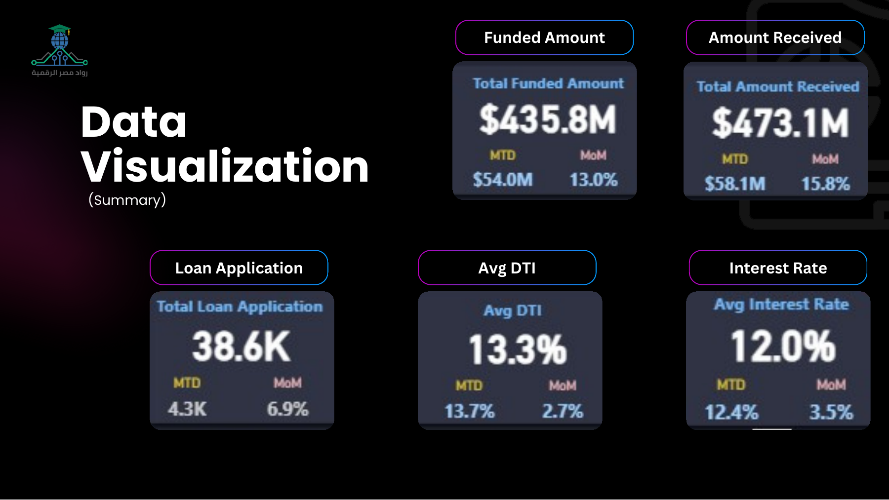
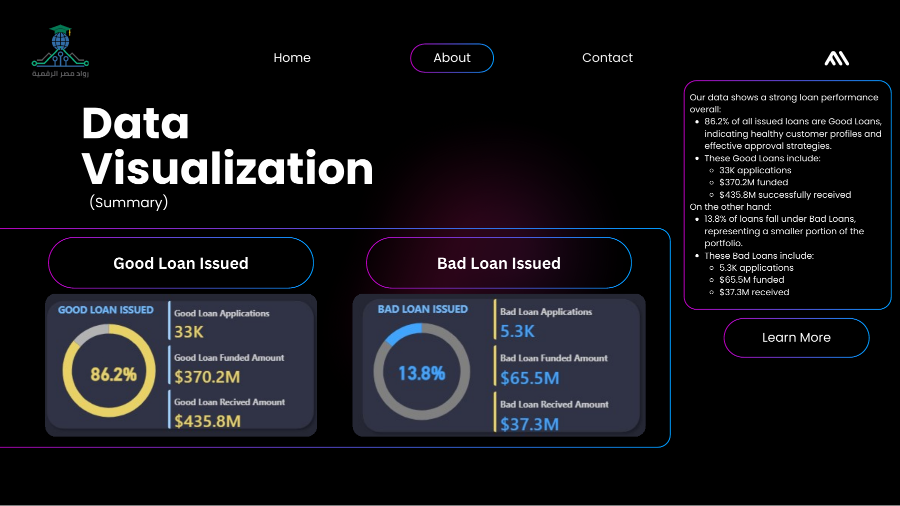
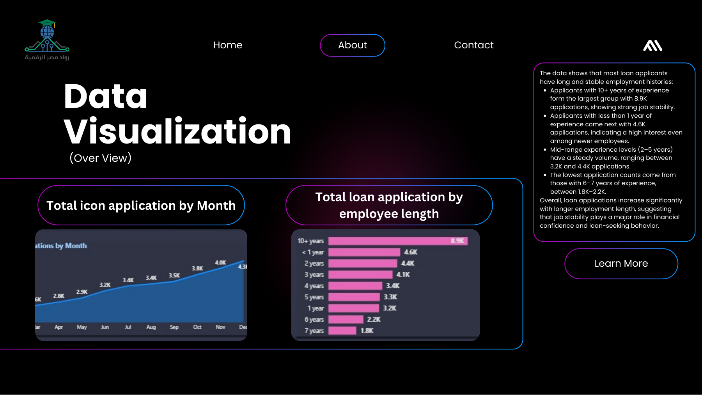

# Bank Loan Analysis

SQL analysis and a Power BI report for exploring loan applications, funded amounts, repayments and loan-status segments.

[Power BI report](dashboard/Graduation%20dashboard.pbix) · [SQL queries](data/Bank_db%20Queries.sql) · [Project presentation](dashboard/Graduate%20Presentation.pdf)

## Problem Statement

A lending portfolio needs more than a total application count. This project examines how funding and received payments vary over time and across borrower attributes, and separates loan statuses to support portfolio monitoring.

## Report Preview

[View the existing loan-summary presentation](dashboard/Graduate%20Presentation.pdf)

Dashboard slides from the committed presentation:

The committed presentation includes a loan-summary preview on page 8. It is not a newly refreshed Power BI report. The PBIX contains Summary, OverView and Details report pages, plus an empty Page 1.

## Methodology

1. **Inspect the loan table:** query `BankLoanDB.bank_loan_data` and its application-level fields.
2. **Calculate portfolio KPIs:** application count, funded amount, amount received, interest rate and debt-to-income ratio.
3. **Compare loan statuses:** the SQL groups `Fully Paid` and `Current` as good loans and `Charged Off` as bad loans.
4. **Explore segments:** aggregate by issue month, term, employment length, home ownership, grade and loan purpose.
5. **Present results:** explore the Summary, OverView and Details pages in Power BI Desktop.

The status labels are analytical categories used by this project. A Current loan is not a guarantee of eventual repayment.

## Insights

- Application volume, funded amount and received payments answer different questions and should be reviewed together.
- Loan-status segmentation helps distinguish exposure from money already received.
- Employment, purpose and home-ownership breakdowns support further investigation, but do not establish causes of default.

These are interpretations supported by the query structure. This README does not invent portfolio totals or claim that the dataset has been refreshed.

## Business Recommendations

- Monitor charged-off exposure alongside funded and received amounts.
- Compare segments using both volume and risk measures rather than volume alone.
- Investigate unusual monthly changes before drawing conclusions about lending performance.
- Use validated credit-risk processes for lending decisions; this portfolio analysis is not an automated approval model.

## Key Fields

| Field | Meaning in the analysis |
| --- | --- |
| `id` | Loan application identifier |
| `issue_date` | Loan issue date |
| `loan_amount` | Funded loan amount |
| `total_payment` | Recorded payments received |
| `loan_status` | Fully Paid, Current or Charged Off |
| `int_rate`, `dti` | Interest rate and debt-to-income ratio |
| `term`, `emp_length` | Term and employment-length segments |
| `home_ownership`, `grade`, `purpose` | Borrower and loan attributes |

## How to Explore

1. Download the PBIX and open it in Power BI Desktop.
2. Review the report pages using the existing embedded data.
3. Before refreshing, inspect **Data source settings** and replace any machine-specific source locations or credentials.
4. To run the SQL, supply a SQL Server database named `BankLoanDB` with a compatible `bank_loan_data` table.

## Reproducibility Notes

- The standalone source database and a database-creation script are not included in this repository.
- Some SQL examples hard-code November or December 2021. They are fixed-month examples, not a dynamic current MTD calculation.
- The committed SQL contains encoding artifacts that need review before execution. The original script is preserved in this documentation pass.
- Some older supporting documents contain generic e-commerce examples. The overview above follows the actual loan SQL and PBIX page structure instead.

## Repository Guide

- `dashboard/`: Power BI file and project presentation.
- `data/Bank_db Queries.sql`: loan KPI and segmentation queries.
- `src/`: original supporting project documents.
